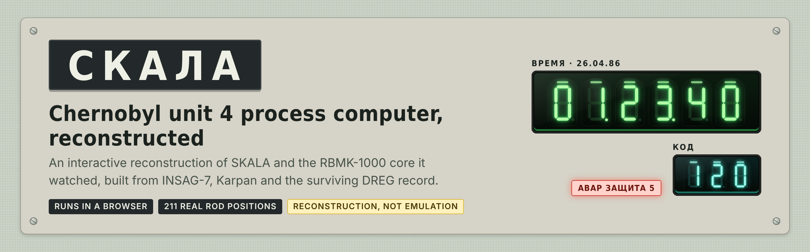
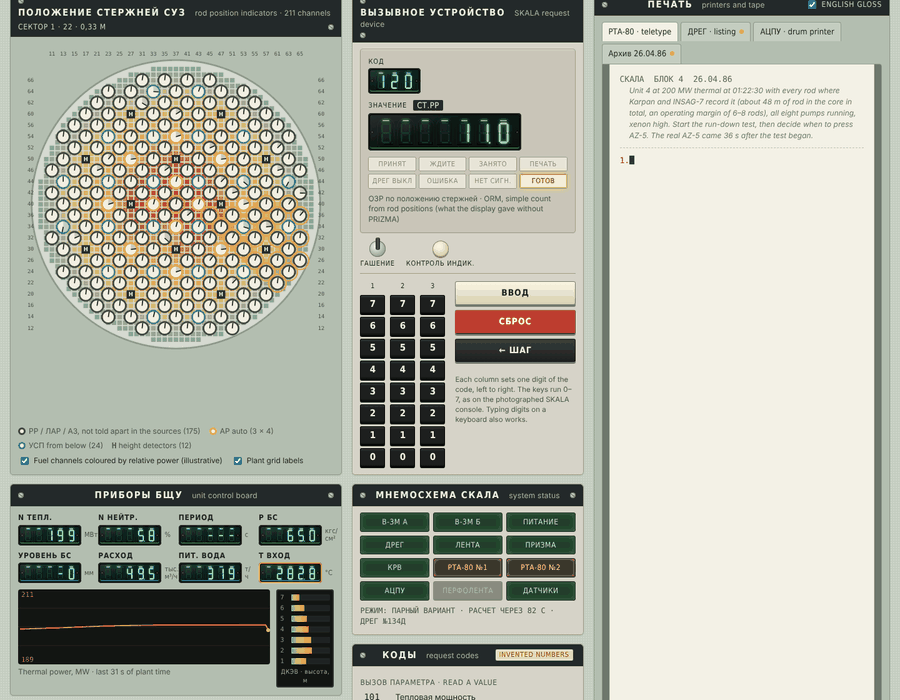
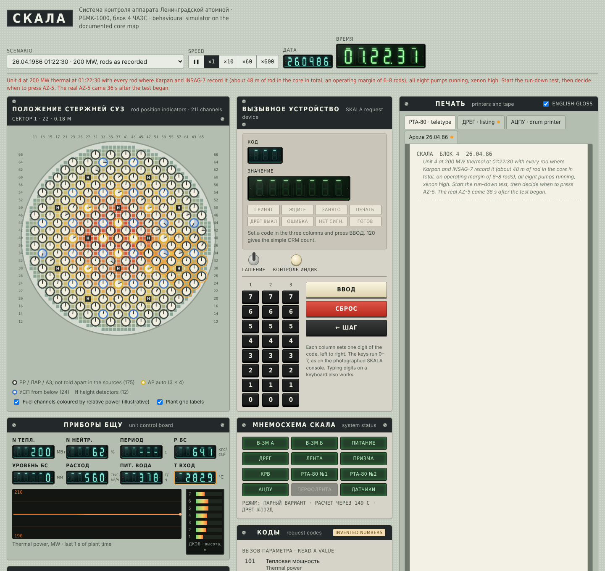
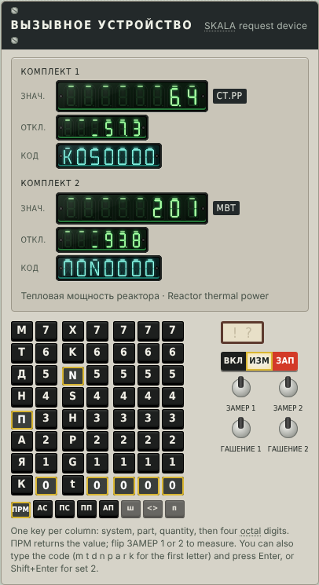
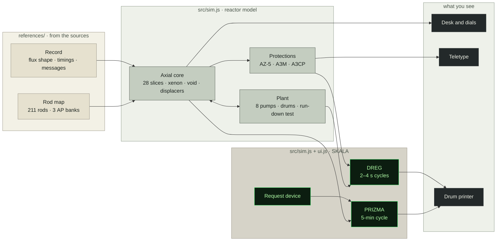

<p align="center">
  
</p>

<p align="center">
  <a href="https://renderedsheep.github.io/skala-simulator/"></a>
</p>

<p align="center">
  
  
  
  <a href="docs/validation.md"></a>
  <a href="LICENSE"></a>
  <a href="NOTICE"></a>
</p>

<a href="https://hackaday.com/2026/03/03/inside-skala-how-chernobyls-reactor-was-actually-controlled/" title="SKALA (СКАЛА): the process computer of each RBMK-1000 unit. It read thousands of sensors, calculated the core state and logged events, but did not control the reactor.">SKALA</a> (СКАЛА) was the process computer of each <a href="https://en.wikipedia.org/wiki/RBMK" title="RBMK-1000: the Soviet graphite-moderated, water-cooled reactor type at Chernobyl, with 1661 fuel channels and 211 control rods. Its design flaws were central to the accident.">RBMK-1000</a> reactor. At Chernobyl unit 4 it watched thousands of sensors, ran the <abbr title="PRIZMA (ПРИЗМА): SKALA’s core-calculation program. About every 5 minutes it computed the power in each fuel channel and the operating margin (ORM).">PRIZMA</abbr> core calculation every five minutes and logged events to its diagnostic recorder, <a href="https://archive.org/details/dreg-protocol-last-40-seconds-of-chernobyl" title="DREG (ДРЕГ): SKALA’s low-priority logging program. Every 2–4 s it wrote signals and parameters to magnetic tape; its printout is the main second-by-second record of the accident.">DREG</a>. It did not control the reactor. The operators did, asking SKALA for numbers by keying codes on a request device and waiting for the answer to light up.

This project rebuilds that experience in a web page: the rod-position wall, the unit control board, the SKALA console and its printers, driven by a reactor model built on the real control-rod map of unit 4. You can run the plant from routine operation, or step into the 01:22:30 state of 26 April 1986 and follow, or change, what happened next.

<sub>Dotted and linked terms show a short definition when you hover over them.</sub>

> [!IMPORTANT]
> **Read this first. This is a reconstruction, not an emulation and not a reactor simulator.**
> - **SKALA's software was never published**, nor the <abbr title="V-3M (В-3М): the Soviet process-control computers SKALA ran on. Two worked together in “paired” mode.">V-3M</abbr> computer's instruction set. No original code runs here. The console's behaviour is rebuilt from surviving printouts, messages, timings and testimony.
> - **Most request codes are invented, in a real grammar.** The code structure, the two display sets and a handful of real codes come from the [Chornobyl Family](https://www.youtube.com/watch?v=1JSP_gVXZTs) reconstruction, built with former Chernobyl staff. That reconstruction follows the modernized SKALA of unit 3, which ran until 2000, so unit 4's codes in 1986 may have differed in detail. The full code table is not public, so the other codes follow the same rules but are this simulator's own. Printout layouts are reconstructions too.
> - **The physics is simplified and tuned.** It is a one-dimensional model along the core's height. The explosion timing matches the record because one parameter was tuned to make it match, and a 7 % change to that parameter changes the outcome. See [validation](docs/validation.md).
> - **Use it to understand the mechanisms**, such as why <a href="https://en.wikipedia.org/wiki/Chernobyl_disaster" title="AZ-5 (АЗ-5): emergency protection level 5, the full shutdown button. Pressed at 01:23:40, it raised power in the lower core for the first seconds because of the rods’ graphite displacers.">AZ-5</a> raised power first, or why the <abbr title="ORM, operating reactivity margin (ОЗР): how much control-rod absorber is in the core, counted as fully inserted manual rods. The rules required at least 15. At 01:22:30 it was about 6–8.">operating margin</abbr> mattered. Do not treat it as evidence for exact numbers.
>
> Every screen element is labelled on the page as documented or reconstructed. Corrections with sources are very welcome ([how](CONTRIBUTING.md)).

<p align="center">
  
  <br>
  <sub>The last seconds of a 26 April run: AZ-5, the overpower trip, the teletype cut off when SKALA loses power.</sub>
</p>

---

## What you can do with it

| Try this | What you get |
|---|---|
| **Read the plant as the shift did** | 211 <a href="https://en.wikipedia.org/wiki/Synchro" title="Selsyn (synchro): an electrical angle-transmitter that turns a rod’s position into a needle angle on a control-room dial.">selsyn</a>-style dials on the real channel grid, eight <a href="https://en.wikipedia.org/wiki/Vacuum_fluorescent_display" title="VFD, vacuum fluorescent display: glowing green digit tubes common on Soviet equipment of the period.">VFD</a> readouts, a power trend and axial power bars. |
| **Query SKALA** | Key a seven-character code (system, part, quantity, address, such as П0N0000 for thermal power), flip ЗАМЕР, and wait for the value, its deviation from the nearest setpoint, and the code on one of two display sets. <a href="https://www-pub.iaea.org/MTCD/publications/PDF/Pub913e_web.pdf" title="ORM, operating reactivity margin (ОЗР): how much control-rod absorber is in the core, counted as fully inserted manual rods. The rules required at least 15. At 01:22:30 it was about 6–8. Explained in INSAG-7.">ORM</a>, the margin that mattered most that night, was never on a continuous display. You had to ask. |
| **Watch the printers** | The <a href="https://en.wikipedia.org/wiki/Teleprinter" title="RTA-80 (РТА-80): a Soviet roll-paper teleprinter. SKALA printed urgent messages on two of them at 7 characters per second.">RTA-80</a> teletype types at its real 7 characters per second. DREG prints in numbered cycles. PRIZMA arrives on <a href="https://en.wikipedia.org/wiki/Continuous_stationery" title="Fanfold: continuous printer paper with tractor holes along both edges. SKALA’s drum printer used plain white perforated fanfold.">fanfold</a> paper at the end of its 5-minute cycle, as a channel map of the core printed in two halves. The teletype also logs every setpoint a measured parameter crosses. With sound on you hear them print, and every emergency protection sounds the alarm horn. |
| **Replay 26 April 1986** | Start the <a href="https://en.wikipedia.org/wiki/Chernobyl_disaster" title="Turbine run-down test: could a coasting turbine-generator power the pumps until diesel generators took over? It began at 01:23:04 when turbine 8’s stop valves closed.">run-down test</a> at 01:23:04, press AZ-5 at 01:23:40, and compare your run with the surviving record in the archive tab. |
| **Ask "what if?"** | Run the same test with the rod pattern of 00:39, try AZ-5 without the test, or try to shut the reactor down safely. Pick rods by sector or draw your own group on the dial panel, and a short debrief tells you how the run went. |
| **See what nobody could see** | A fold-out panel shows the <abbr title="Reactivity: how far the chain reaction is from steady. Positive means power rises; above +1 $ it runs on prompt neutrons alone.">reactivity</abbr> balance and the axial <a href="https://en.wikipedia.org/wiki/Neutron_flux" title="Neutron flux: how many neutrons pass through a region each second. Power follows it, so the flux shape is the power shape.">flux</a>, <a href="https://en.wikipedia.org/wiki/Void_coefficient" title="Steam void: in the RBMK more steam meant more reactivity (a positive void coefficient), so boiling could feed a power rise.">steam</a> and <a href="https://en.wikipedia.org/wiki/Iodine_pit" title="Xenon-135: a fission product that absorbs neutrons strongly and builds up for hours after power is reduced.">xenon</a> profiles in real time. |

<table>
  <tr>
    <td width="62%"></td>
    <td width="38%"></td>
  </tr>
  <tr>
    <td><sub>The control-room wall: rod dials, SKALA console, printers.</sub></td>
    <td><sub>The request device, laid out after the Chornobyl Family reconstruction.</sub></td>
  </tr>
</table>

## Run it

- **Online:** open the [live simulator](https://renderedsheep.github.io/skala-simulator/).
- **Offline:** download this repository and double-click `index.html`. It is a single file with no install and no server. An internet connection is only used for the PT Sans and PT Mono typefaces.

The **training manual** walks through every panel, lists the request codes and gives eight graded exercises, from reading the plant to replaying the accident: [PDF](docs/SKALA-Training-Manual.pdf) · [read on GitHub](docs/SKALA-Training-Manual.md). In Russian (на русском): [PDF](docs/SKALA-Training-Manual.ru.pdf) · [read on GitHub](docs/SKALA-Training-Manual.ru.md).

## Documented or reconstructed

 taken from the sources&nbsp;&nbsp;
 worked out from the sources&nbsp;&nbsp;
 made up so the simulator works

| Element | Status | Basis |
|---|---|---|
| Positions of all 211 control rods at 00:39 and 01:22:30 |  | <a href="http://accidont.ru/memo/Karpan_03.html" title="Nikolai Karpan: nuclear physicist who worked at the Chernobyl plant; author of «Чернобыль. Месть мирного атома» (2005), which reproduces the rod maps and logs this project uses.">Karpan</a>'s cartograms, checked cell by cell against <a href="https://www-pub.iaea.org/MTCD/publications/PDF/Pub913e_web.pdf" title="INSAG-7: the 1992 IAEA International Nuclear Safety Advisory Group report that revised the first Soviet account of the accident.">INSAG-7</a> Fig. II-6 |
| Which rods are <abbr title="АР, automatic regulator: 12 rods in three banks of four that hold power at the setpoint. They had no graphite displacers.">АР</abbr> (automatic) and <abbr title="УСП, shortened absorber rods: 24 rods inserted from below to shape the power at the bottom of the core.">УСП</abbr> (from below), and the 12 detector cells |  | Karpan's map typography |
| Which of the other 175 rods are <abbr title="РР: manual control rods, each with a 6.2 m absorber and a 4.5 m graphite displacer below it.">РР</abbr>, <abbr title="ЛАР: local automatic regulator rods, which regulate power zone by zone at higher power.">ЛАР</abbr> or <abbr title="АЗ: the 24 emergency-protection rods, held at the top until a scram.">АЗ</abbr> |  | Not stated in any source found. Shown as one group. |
| Teletype speed, message format and cut-off |  | Karpan pp. 359–361 |
| DREG cycle numbering, "=0" convention, message texts |  | DREG transcript, Karpan, INSAG-7 |
| DREG raw signal codes |  | Only <abbr title="К06L005 =1: the one raw DREG signal code known, “pressure rise in the reactor space”, meaning fuel channels had burst. Cycle №138Д, 01:23:49 (Karpan p.360).">К06L005</abbr> is known. Other lines show text only. |
| PRIZMA 5-minute cycle, odd-hour printouts, restart time |  | Karpan pp. 338, 350–351 |
| Pump numbering, coast-down and trip times |  | Karpan App. 3 oscillogram chronology |
| Fuel-channel positions |  | Every lattice cell not used by a rod or detector |
| Xenon distribution at 01:22:30 |  | Solved backwards from the measured flux shape (INSAG-7 Fig. II-5) |
| Request device layout, code grammar, display sets, error codes 301/303, and codes П0N0000, Т0N7100, К0S0000, К5N0000, К0S/К0G + channel |  | [Chornobyl Family](https://www.youtube.com/watch?v=1JSP_gVXZTs), built with former Chernobyl staff, after the modernized unit 3 system (in service to 2000). Channel coordinates are <a href="https://en.wikipedia.org/wiki/Octal" title="Octal: counting in base 8, with digits 0–7. The plant's channel grid never uses the digits 8 or 9.">octal</a>, which the plant grid confirms. |
| All other request codes, the subprogram numbers except 0301, and ПС/АС as the falling setpoints |  | Same grammar, but the full table is not public |
| PRIZMA channel cartogram form (two halves, rulers, four-character cells) |  | [Chornobyl Family](https://www.youtube.com/watch?v=1JSP_gVXZTs) printer video. Per-channel flow and boiling margin left out: not modelled |
| PRIZMA summary lines, rod cartogram layout, teletype setpoint wording |  | No original sheet reproduced |
| Rod "sectors" and the <abbr title="СИУР, senior reactor control engineer: the operator at the reactor desk. On 26 April 1986, Leonid Toptunov.">SIUR</abbr> assist |  | Simulator conveniences, labelled as such |

## How close it gets

| Check | Record | Simulator |
|---|---|---|
| <abbr title="ORM, operating reactivity margin (ОЗР): how much control-rod absorber is in the core, counted as fully inserted manual rods. The rules required at least 15. At 01:22:30 it was about 6–8.">Operating margin</abbr> at 01:22:30, from the real rods (not tuned) | 6–8 rods | **6.4** |
| Operating margin with the 00:39 rods | 16.5 | **14.3** |
| Coolant flow just before AZ-5 | 51 000 m³/h | **50 400** |
| Overpower trip after AZ-5 | about 3 s | **2.7 s** |
| Reactor destroyed after AZ-5 | about 5 s | **5.4 s** |

> [!WARNING]
> The last two rows were tuned. Change the <abbr title="How strongly the short water columns in the control-rod channels absorb neutrons. Water absorbs far more than the graphite displacers that push it out, which drives the tip effect.">water-column absorption</abbr> by 7 % and the 01:22:30 state either stops exploding or the safer 00:39 case starts to trip. INSAG-7 (p.142) reports the same extreme sensitivity in the Soviet three-dimensional codes. Full results, the reasoning and how to reproduce them: [docs/validation.md](docs/validation.md).

## How it fits together



## Repository layout

```
skala-simulator/
├── index.html              the simulator, built from src/ (GitHub Pages serves this)
├── src/
│   ├── template.html       page layout and styles
│   ├── sim.js              reactor physics, plant, protections, SKALA programs
│   ├── ui.js               dials, VFD readouts, request device, printers
│   ├── data.js             core map in JavaScript (generated, do not edit)
│   ├── glossary.js         definitions behind the dotted hover terms
│   ├── gen_data.py         rebuilds data.js from references/
│   └── build.py            rebuilds index.html from the files above
├── references/             data and notes recreated from the sources, with page numbers
│   ├── rbmk4_cps_map.csv           all 211 rods + 12 detector cells, both maps
│   ├── insag7_fig_II-6_rods_012230.csv
│   ├── fuel_lattice_inferred.csv
│   ├── oscillogram_chronology_karpan_app3.csv
│   ├── dreg_table_karpan_app3.csv
│   ├── message_catalogue.csv
│   ├── validation_points.csv
│   ├── insag7-findings.md · karpan-findings.md
│   └── sources.md                  where every source can be found
├── tests/check.js          checks against the historical record (prints PASS/FAIL)
├── docs/
│   ├── SKALA-Training-Manual.pdf   the training manual (also as .md)
│   ├── SKALA-Training-Manual.ru.pdf  the same manual in Russian (also as .md)
│   ├── validation.md
│   └── assets/             images for this README
├── .github/workflows/check.yml     runs the checks and verifies index.html on every push
├── CONTRIBUTING.md · CHANGELOG.md · CITATION.cff · LICENSE · NOTICE · LICENSES/
└── README.md
```

## Changing it

You need Python 3 to rebuild, and Node.js to run the checks.

```bash
cd src
python3 gen_data.py      # only if you changed a CSV in references/
python3 build.py         # rewrites ../index.html
cd ..
node tests/check.js      # every line should say PASS
```

## Sources

- IAEA, [INSAG-7: The Chernobyl Accident: Updating of INSAG-1](https://www-pub.iaea.org/MTCD/Publications/PDF/Pub913r_web.pdf), Russian edition, 1993.
- Н.В. Карпан, *Чернобыль. Месть мирного атома*, Kyiv, 2005. Part IV is [online](http://accidont.ru/memo/Karpan_03.html).
- L. Sturm and R. Plaskov, [DREG protocol transcript of the last 40 seconds](https://archive.org/details/dreg-protocol-last-40-seconds-of-chernobyl), CC BY-NC 4.0.
- А.С. Дятлов, [*Чернобыль. Как это было*](http://lib.ru/MEMUARY/CHERNOBYL/dyatlow.txt_with-big-pictures.html).
- Chornobyl Family, [Exploring SKALA](https://www.youtube.com/watch?v=ZbaptQh2AM4), and their working reconstruction of the SKALA console.

Page-by-page notes are in [`references/`](references/). No books or reports are redistributed here.

## Thank you

This reconstruction rests on the shoulders of experts and their work (and some impressive AI to tie it together).

- **Nikolai Karpan**, whose book *Чернобыль. Месть мирного атома* preserved the rod maps, shift logs and recorder data the core model is built on.
- **The IAEA's International Nuclear Safety Advisory Group**, whose [INSAG-7](https://www-pub.iaea.org/MTCD/publications/PDF/Pub913e_web.pdf) report supplied the measured flux shape, the rod positions to cross-check against, and a frank account of the reactor's design flaws.
- **[Chornobyl Family](https://www.youtube.com/watch?v=ZbaptQh2AM4)**, whose restoration of real SKALA hardware shows how the console, printers and DREG actually behaved.
- **Linus Sturm and R. Plaskov**, for transcribing the DREG protocol of the last 40 seconds.
- **Claude (Anthropic)**, the AI assistant that read the Russian sources side by side with the English ones, extracted the rod map from the book's typography, cross-checked it cell by cell against INSAG-7, and ran many simulation runs to test the model against every figure in the record.

> [!NOTE]
> Working this way was a lesson in what AI can do to aid historical reconstruction. Its value was not knowing the answers, but holding scattered Russian and English sources together, reconstructing them into tabulated data, and testing them against each other far faster than one person could. Every finding was checked against the source documents, and the gaps are marked accordingly.

## License

Built by Fernand G. (2026).

- **Code** (`src/`, `tests/`, the build and the page itself) is under the [Apache License 2.0](LICENSE).
- **Content** (the training manuals, docs, reference data and this README) is under [Creative Commons Attribution-ShareAlike 4.0 (CC BY-SA 4.0)](https://creativecommons.org/licenses/by-sa/4.0/).
- **One exception:** the DREG lines from L. Sturm and R. Plaskov's transcript stay under their [CC BY-NC 4.0](https://creativecommons.org/licenses/by-nc/4.0/) license.

---

<p align="center"><sub>
On 26 April 1986 reactor No. 4 of the Chernobyl Nuclear Power Plant was destroyed at about 01:23:45.<br>
Two plant workers died that night. 134 people were later diagnosed with acute radiation syndrome.<br>
This project is made in their memory and for the people who worked to understand what happened.
</sub></p>
